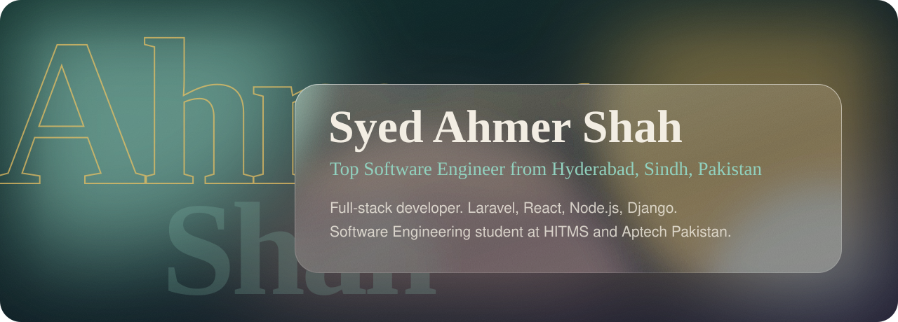

 

## About

Hi, I'm Ahmer. I'm a software engineer and full-stack developer from **Hyderabad, Sindh, Pakistan**, building fast, secure web apps and writing up how they're made. I study Software Engineering at **HITMS** and follow a three-year Advanced Diploma at **Aptech Pakistan**, a mix of theory and hands-on practice. Both finish in 2028.

I use AI tools such as Claude Code, GitHub Copilot and Cursor to move faster, and I keep the thinking my own. My goal: become a strong full-stack developer and build things that last.

- Writing: **40+ articles** across seven platforms, plus engineering logs and case studies
- Open to freelance and contract work, remote worldwide on PKT (UTC+5)

## Projects

| Project | What it is | Built with |
| --- | --- | --- |
| [**HolidayOps**](https://github.com/ahmershahdev/holidayops) | A working-day API for 250 countries and 624 regions, with REST, iCal feeds, digests and signed webhooks in English, Urdu and Arabic (RTL). 481 automated tests. | Django, React, MySQL, Redis, Celery |
| [**Ahmer Institute of Technology**](https://github.com/ahmershahdev/Ahmer-Institute-of-Technology) | A university admission and examination portal rebuilt from my internship: 31 tables, four portals, race-safe approvals, nonce-based CSP. | PHP, Laravel, MySQL |
| [**GleanGrid**](https://ahmershah.dev/projects/gleangrid) | A farmers market pre-order platform for local markets in Hyderabad. | Laravel, React |
| [**Zovita+**](https://ahmershah.dev/projects/zovita) | A health platform. | Laravel, React |
| [**BookMyMovie**](https://ahmershah.dev/projects/bookmymovie) | A movie booking platform. | Laravel, React |
| [**Commerza**](https://ahmershah.dev/projects/commerza) | A custom e-commerce storefront with an operations panel. | PHP, MySQL |

Full case studies: [ahmershah.dev/projects](https://ahmershah.dev/projects).

## Experience

**Full Stack Developer intern at XCL Technologies** (on-site, Hyderabad, 15 July to 15 August 2026). Built features for a university admission and examination portal: registration with e-mail verification, document submission, validation and flagging, PDF fee challans, exam slips and a Super Admin panel.

## Education

| When | Where | What |
| --- | --- | --- |
| Nov 2024 to Dec 2028 | Hyderabad Institute for Technology and Management Sciences | Bachelor's in Software Engineering (in progress) |
| Aug 2025 to Sep 2028 | Aptech Pakistan | Advanced Diploma in Software Engineering, ADSE (in progress) |
| Jul 2022 to Jul 2024 | Superior College of Science, Hyderabad | HSC, Pre-Engineering, Grade A, 70.45% |
| Apr 2012 to Jul 2022 | St. Bonaventure's High School, Hyderabad | SSC, Computer Science, Grade A-1, 83.90% |

## Find me elsewhere

**Code and credentials:** [GitHub](https://github.com/ahmershahdev), [LeetCode](https://leetcode.com/u/syedahmershah), [HackerRank](https://www.hackerrank.com/profile/syedahmershah), [Credly](https://www.credly.com/users/syedahmershah/), [Coursera](https://coursera.org/learner/syedahmershah)

**Professional:** [LinkedIn](https://linkedin.com/in/syedahmershah), [Wellfound](https://wellfound.com/u/syedahmershah), [Arc.dev](https://arc.dev/@syedahmershah), [AWS Builder Center](https://builder.aws.com/community/@syedahmershah), [Crunchbase](https://www.crunchbase.com/person/syed-ahmer-shah)

**Social, @ahmershahdev:** [Instagram](https://instagram.com/ahmershahdev), [TikTok](https://tiktok.com/@ahmershahdev), [YouTube](https://youtube.com/@ahmershahdev), [Facebook](https://www.facebook.com/ahmershahdev), [X](https://x.com/ahmershahdev), [Bluesky](https://bsky.app/profile/bluesky.ahmershah.dev), [Pinterest](https://www.pinterest.com/ahmershahdev/)

**Design:** [Dribbble](https://dribbble.com/syedahmershah), [Behance](https://www.behance.net/syedahmershah)

**Writing:** [Blog](https://ahmershah.dev/blogs), [HackerNoon](https://hackernoon.com/u/syedahmershah), [RSS](https://ahmershah.dev/blogs/rss.xml)

**Hire me:** [Fiverr](https://www.fiverr.com/ahmershahdev), [Upwork](https://www.upwork.com/freelancers/~01d033487ce8ecd83f), [Freelancer](https://www.freelancer.com/u/syedahmershah), [Contra](https://contra.com/syedahmershah), [Clutch](https://clutch.co/profile/syed-ahmer-shah), [G2](https://www.g2.com/products/syed-ahmer-shah/), [Trustpilot](https://www.trustpilot.com/review/ahmershah.dev)

Business enquiries: [sales@ahmershah.dev](mailto:sales@ahmershah.dev). Support: [support@ahmershah.dev](mailto:support@ahmershah.dev).

 

